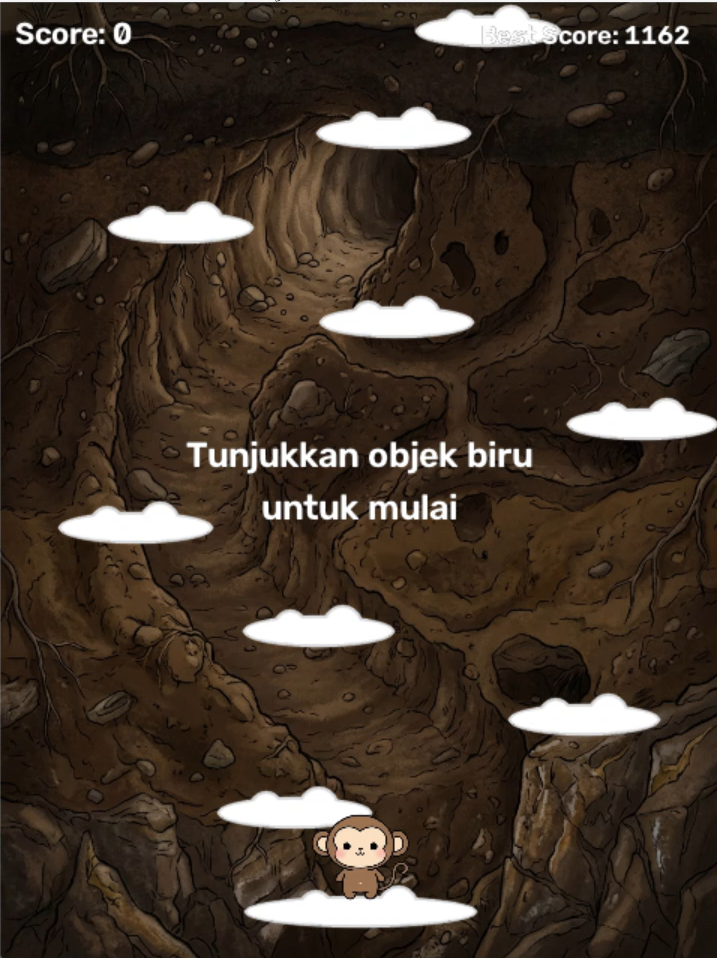
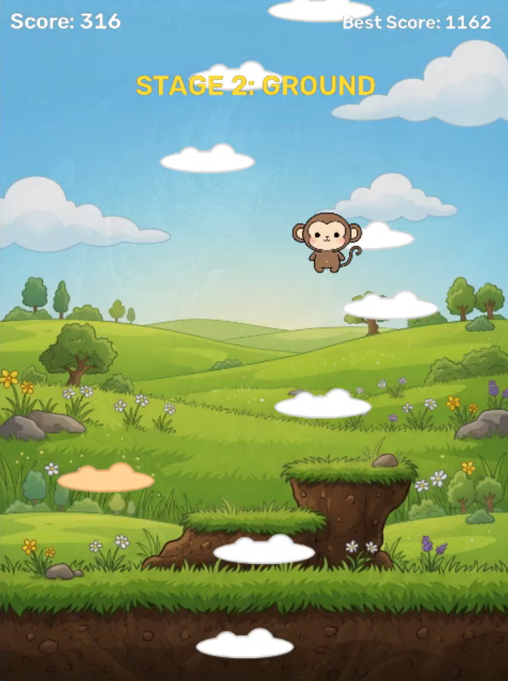
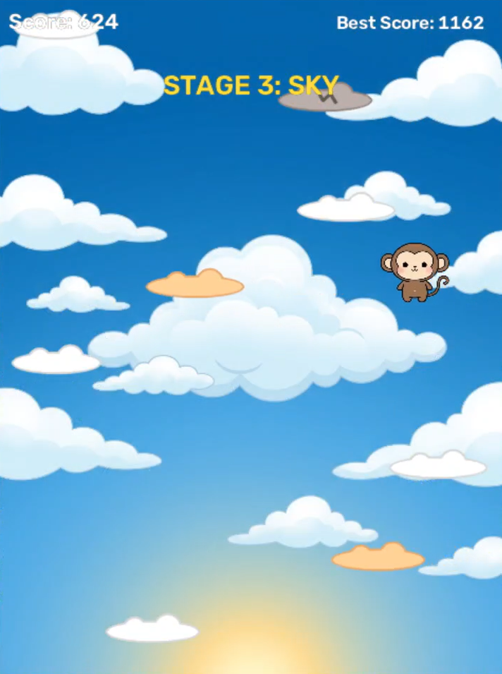
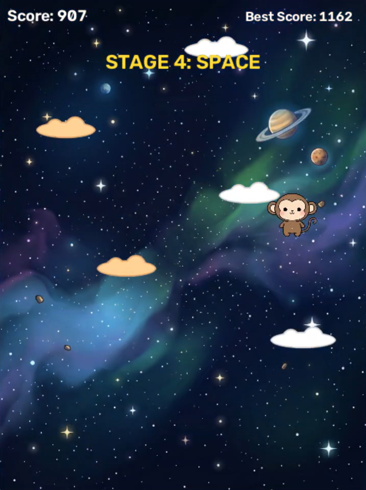
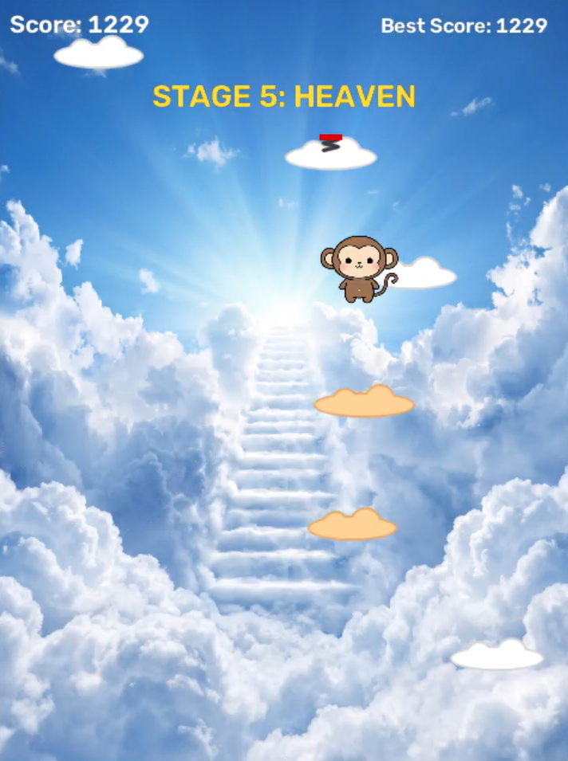
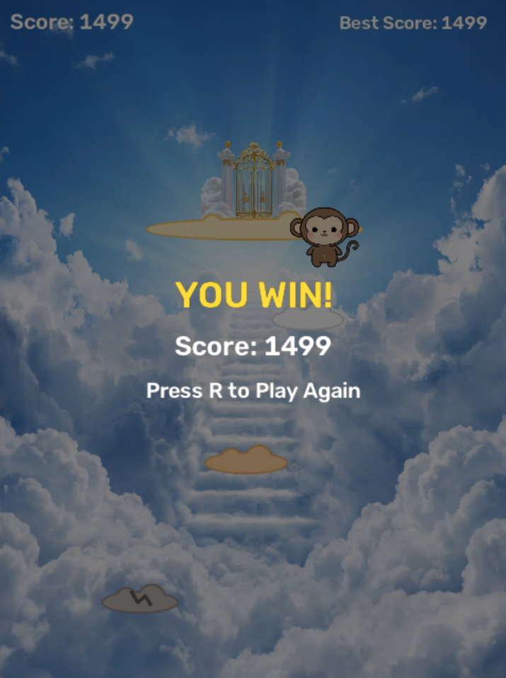
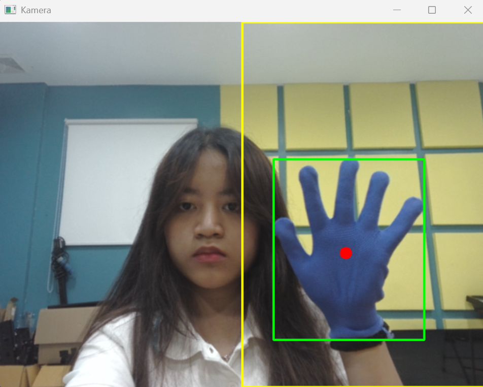
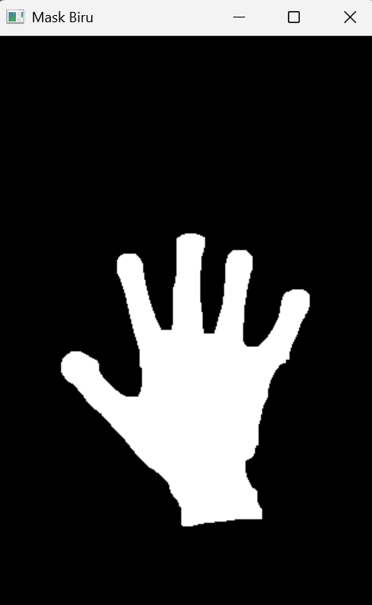

# Sky Jump - Game Lompat Awan Berbasis Deteksi Warna

Game ala Doodle Jump / Pou Sky Jump yang dikontrol **tanpa keyboard dan mouse**. Pemain memakai **sarung tangan biru** dan menggerakkannya di depan webcam. Posisi tangan dideteksi dengan pengolahan citra (segmentasi warna HSV), lalu dipakai untuk menggeser karakter ke kiri dan kanan.

## Demo

**Video demo:** [https://drive.google.com/file/d/1SuDDfN5srzoD21Tnuq42xdAo_Nn_mtlJ/view?usp=sharing ]

| Game |
|---|
|  |
|  |
|  |
|  |
|  |
|  |

| Deteksi Kamera & Mask |
|---|
|  |
|  |

## Fitur

- Kontrol tangan memakai warna biru, hanya di **setengah layar kanan** kamera (satu tangan).
- Karakter melompat otomatis, pemain hanya menggeser ke kiri dan kanan.
- 4 jenis awan:
  - **Normal**: awan putih biasa.
  - **Bergerak**: awan oranye yang bergeser kiri-kanan.
  - **Pecah**: awan abu-abu yang langsung hilang setelah dipijak.
  - **Per**: awan dengan per merah yang membuat lompatan jauh lebih tinggi.
- 5 stage dengan background berbeda: Underground, Ground, Sky, Space, Heaven. Pergantian stage memakai efek fade.
- Tingkat kesulitan naik seiring skor (awan makin jauh, makin sempit, dan lebih banyak awan bergerak atau pecah).
- Pintu surga di akhir permainan. Sentuh pintunya untuk menang.
- Ada skor dan skor terbaik.

## Cara Kerja Pengolahan Citra

Setiap frame dari kamera diproses dengan alur berikut (fungsi `detect_hand`):

1. **Flip horizontal** supaya tampilan seperti cermin.
2. **ROI**: hanya setengah kanan frame yang diproses.
3. **Gaussian Blur** untuk mengurangi noise.
4. **Konversi BGR ke HSV** supaya warna lebih tahan terhadap perubahan cahaya.
5. **Thresholding warna** dengan `cv2.inRange` menghasilkan mask hitam-putih (biru jadi putih).
6. **Operasi morfologi**: *opening* untuk menghapus bintik kecil dan *closing* untuk menutup lubang kecil.
7. **Kontur**: dicari semua kontur, yang luasnya kecil dibuang, lalu diambil yang terbesar.
8. **Centroid** dihitung dengan `cv2.moments`, lalu posisi X dinormalisasi menjadi angka 0 sampai 1.
9. **Smoothing** (rata-rata bergerak) supaya gerakan karakter tidak bergetar.

Hasilnya dipakai sebagai posisi X karakter di dalam game.

## Cara Bermain

1. Jalankan game, lalu tunjukkan sarung tangan biru di **setengah kanan** layar kamera (area kotak kuning).
2. Gerakkan tangan ke kiri dan kanan untuk menggeser karakter supaya mendarat di awan.
3. Naik setinggi mungkin untuk melewati semua stage.
4. Sentuh pintu surga untuk menang. Jatuh keluar layar berarti kalah.

| Tombol | Fungsi |
|---|---|
| `R` | Main lagi |
| `Q` | Keluar |

> Klik salah satu jendela game terlebih dahulu supaya tombol keyboard terbaca.

## Struktur Folder

```
PROJECT-1_PCV/
├── skyjump.py          # kode utama
├── player.png            # gambar karakter (PNG transparan)
├── door.png              # gambar pintu surga (PNG transparan)
├── underground.jpg       # background stage 1
├── ground.jpg            # background stage 2
├── sky.jpg               # background stage 3
├── space.jpg             # background stage 4
├── heaven.jpeg           # background stage 5
├── docs/                 # screenshot untuk README
└── README.md
```

Semua gambar harus berada di folder yang **sama** dengan `skyjump.py`.

## Pengaturan

Semua pengaturan ada di bagian atas `skyjump.py`:

| Pengaturan | Fungsi |
|---|---|
| `LOWER_BLUE`, `UPPER_BLUE` | Rentang warna biru (HSV). Ubah kalau sarung tangan tidak terdeteksi |
| `SMOOTH` | Kehalusan gerakan (kecil = halus tapi lambat) |
| `EDGE_MARGIN` | Seberapa jauh tangan harus bergerak ke tepi area |
| `JUMP`, `SPRING`, `GRAVITY` | Tinggi lompat dan gravitasi |
| `STAGES` | Daftar background dan skor awal tiap stage |
| `GATE_SCORE` | Skor tempat pintu surga muncul |

Untuk mencoba cepat sampai ke pintu surga, kecilkan `GATE_SCORE` dan skor awal di `STAGES`.

## Troubleshooting

- **`FileNotFoundError`**: ada file gambar yang namanya salah atau belum ada di folder game.
- **Jendela kamera hitam atau kamera tidak terbuka**: ubah `CAM_INDEX` menjadi `1`.
- **Tangan tidak terdeteksi**: lihat jendela Mask Biru. Kalau kosong, sesuaikan rentang HSV dengan cahaya ruangan.
- **Pemain bergerak sendiri**: ada benda biru lain di area kanan kamera. Pindahkan atau singkirkan benda itu.

## Teknologi

- Python 3
- OpenCV (`cv2`)
- NumPy
